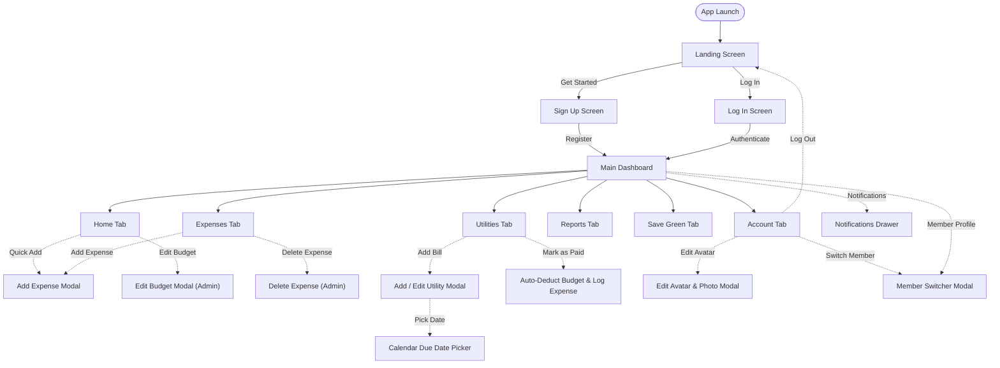

# TipidHome — User Flow

**TipidHome** is a mobile household budgeting and energy-saving app designed for Philippine families to track shared expenses, manage utility due dates, and adopt eco-friendly habits.

---

## 1. Flowchart

---

## 2. Screen Maps

| Screen or State | Main Purpose | Common Next Action |
| :--- | :--- | :--- |
| **Landing Screen** | Introduce TipidHome value proposition and serve as initial gateway | Tap **"Get Started"** to register or **"Log In"** to sign in |
| **Log In Screen** | Authenticate returning users with email and password | Enter credentials and tap **"Log In"**; or tap **"Sign Up"** |
| **Sign Up Screen** | Register a new household user account | Fill in name, email, password, agree to terms, and tap **"Sign Up"** |
| **Home Dashboard (Tab 1)** | View total monthly budget, spending progress bar, deficit/low-budget warnings, and recent activity | Tap **"+"** to add expense, tap **"Edit / Reset"** budget (Admin), or tap **"View All"** activity |
| **Expenses (Tab 2)** | Search, filter, and review all recorded household transactions | Filter by category, search by keyword, tap **"+"** to add, or tap trash icon to delete (Admin) |
| **Utilities & Bills (Tab 3)** | Monitor outstanding bills, schedule due dates, and manage utility accounts | Tap **"+ Add Bill"**, tap **"Mark as Paid"** to auto-deduct (Admin), or tap bill to view due dates |
| **Reports & Analytics (Tab 4)** | Analyze spending habits through animated breakdown charts and budget vs. actual limits | Toggle period (**Weekly / Monthly / Yearly**) or tap replay animation button |
| **Save Green (Tab 5)** | Build daily energy-saving and tipid habits with impact badges | Tap any habit card or checkbox to mark completed/uncompleted |
| **Account (Tab 6)** | Manage user profile, simulate family member roles, configure settings, and sign out | Tap **"Edit Avatar"**, tap **"Switch Active Member"**, or tap **"Log Out"** |
| **Add Expense Modal** | Log a new transaction with title, amount, category, member, and payment method | Enter details and tap **"Save Expense"** (or tap **"Cancel"**) |
| **Add / Edit Utility Modal** | Add or update a utility bill (provider, amount, category, account number, due dates list) | Select due dates with calendar picker and tap **"Save Utility"** |
| **Calendar Due Date Picker** | Select upcoming billing due dates from an interactive monthly calendar | Pick date or tap quick chip (**"15th"** / **"End of Month"**), then tap **"Done"** |
| **Edit & Reset Budget Modal** | Set a new monthly budget limit or reset the billing cycle (Admin only) | Enter new amount and tap **"Save Budget"**, or choose a **Reset** option |
| **Member Switcher Modal** | Switch active family member profile to test Admin vs. Member role permissions | Tap a household member card (**Carl**, **Nova**, or **Mayhen**) |
| **Edit Avatar & Photo Modal** | Customize member avatar using camera, gallery, image URL, emojis, or initials with color swatches | Select image/emoji/color and tap **"Save Avatar"** |
| **Notifications Drawer** | Review activity logs for added expenses, paid bills, budget changes, and avatar edits | Read notifications list or tap **"Mark read"** |

---

## 3. Secondary Flows

### Flow A: Add an Expense
1. User taps the floating **"+"** button on Home or Expenses tab.
2. User enters amount, expense title, selects a category (*Food, Bills, Transport, Medicine, Other*), selects who paid, and chooses payment method (*GCash, Cash, Credit Card, Maya*).
3. User taps **"Save Expense"**.
4. The system validates input, deducts amount from remaining budget, updates progress bar, and adds a notification.

### Flow B: Manage Utility Bill & Auto-Deduction
1. **Add Bill:** User taps **"+ Add Bill"** → enters bill details → selects scheduled due date(s) via Calendar Picker → taps **"Save Utility"**.
2. **Mark as Paid (Admin):** Admin taps **"Mark as Paid"** on a pending bill:
   - Utility status changes to **Paid** (green badge).
   - System automatically generates a linked expense under *Bills*.
   - Amount is automatically deducted from monthly budget and added to Recent Activity.
3. **Undo Payment (Admin):** Admin taps **"Paid (Undo)"** → confirms prompt → auto-recorded expense is deleted, budget is restored, and bill returns to **Pending**.
4. *Member Restriction:* If a non-Admin member attempts to mark paid, edit, or delete a bill, an **"Admin Access Required"** alert appears.

### Flow C: Edit & Reset Monthly Budget
1. User taps **"Edit / Reset"** budget pill on Home tab.
   - *If Member:* An alert denies access (*Admin only*).
   - *If Admin:* Opens Edit Budget Modal.
2. **Edit Limit:** Admin types new budget value → taps **"Save Budget"**.
3. **Reset Options:** Admin taps **"Reset Monthly Budget..."**:
   - *Option 1 (Reset Limit):* Resets budget limit to ₱15,000 without deleting expenses.
   - *Option 2 (Fresh Month):* Resets budget limit to ₱15,000 and clears all expenses for a fresh billing cycle.

### Flow D: Delete Expense (Permission Check)
1. User taps trash icon on an individual expense (or **"Delete All"** button in Expenses tab).
2. **Role Check:**
   - *Member:* Action blocked → displays **"Permission Denied"** alert.
   - *Admin:* Displays confirmation alert → on confirmation, expense is removed, amount restored to budget, and notification is logged.

### Flow E: Customize Avatar & Profile Photo
1. User opens **Account** tab → taps avatar camera badge or **"Edit Avatar"** (or accesses via Member Switcher).
2. User chooses customization method:
   - **Photo Gallery:** Pick and crop image from device photos.
   - **Camera:** Capture a live picture.
   - **Web Image URL:** Paste external image link and tap Apply.
   - **Emoji Avatar:** Select from 18 preset avatar emojis.
   - **Initials & Color:** Type up to 4 characters/initials and select from 10 color swatches.
3. User checks the live circular preview and taps **"Save Avatar"**.

### Flow F: Switch Household Member (Role Simulation)
1. User taps member avatar in top app bar or taps **"Switch Active Member"** in Account tab.
2. Modal displays household members with roles and permissions:
   - **Carl Peñaranda** (*Admin / Head of Household*)
   - **Nova Pico** (*Member / Family Member*)
   - **Marienflor Montecalvo** (*Member / Family Member*)
3. User selects a member → active profile switches immediately, adjusting UI permissions and active badges.
